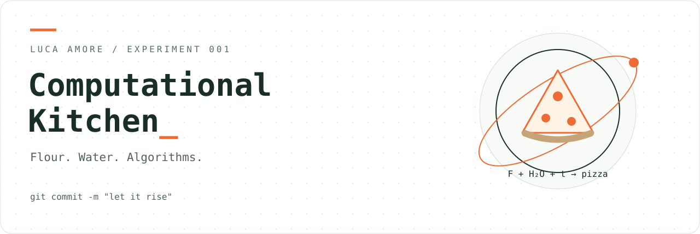

<div align="center">



# Computational Kitchen

**Farina. Acqua. Algoritmi.**

**Un playground di ricette sperimentali assistite dall’AI.**

Una cucina con il codice sorgente. Un ingegnere con il tarocco.

[](https://github.com/lookee/computational-kitchen/actions/workflows/ci.yml)
[](https://github.com/lookee/computational-kitchen/actions/workflows/pages.yml)
[](LICENSE)

[Apri la cucina](https://lookee.github.io/computational-kitchen/) · [Laboratorio pizza](https://lookee.github.io/computational-kitchen/pizza-computational-lab/) · [English](README.md) · [Luca Amore](https://www.lucaamore.com)

</div>

> `git commit -m "lasciamo lievitare"`

Il playground open source di **Luca Amore** dedicato a **ricette sperimentali assistite dall’AI**: uno spazio per esplorare idee, trasformare domande di cucina in codice e imparare cucinando. L’AI aiuta nell’ideazione, nella prototipazione e nella documentazione; le osservazioni in cucina servono a mettere alla prova le ipotesi.

Si parte dalla pizza: bilancio degli ingredienti, formule ispezionabili, ipotesi dichiarate e un programma operativo dall’impasto all’ultima infornata. Gli strumenti pubblicati funzionano nel browser; l’app non integra un servizio AI e non richiede chiavi API.

Il browser fa i conti. L’impasto ha comunque l’ultima parola.

## Esperimento 001 — Pizza Computational Lab

Il progetto nato come Pizza Lab Playground, prima applicazione di questa cucina.

| Parametro | Cosa trovi |
| :--- | :--- |
| Ricetta | Numero e peso dei panetti, idratazione, sale calcolato al 2,5% sulla farina, olio opzionale calcolato |
| Metodo | Diretto, poolish e biga; autolisi opzionale; frigorifero disattivato inizialmente |
| Bimby | TM5, TM6 e TM7; lotti, pesate, quantità per azione e tempi delle lavorazioni |
| Programma | Partenza o prima infornata come riferimento; appretto automatico modificabile; avanzamento in tempo reale |
| Farine | Catalogo tecnico con fonti; curve esplorative di sviluppo e perdita di tenuta |
| Formule | MathML e sorgente LaTeX; modello empirico e modello termico sperimentale |
| Esportazione | PDF locale, scheda elegante spuntabile a penna, calendario e copia della ricetta |
| Riservatezza | Nessun account, backend o telemetria; preferenze nel browser |

L’interfaccia lavora in **italiano e inglese**. Il lievito si visualizza al **decimo di grammo**: è una risoluzione di pesata, non una promessa di accuratezza. Le dosi positive sotto 0,1 g sono segnalate e richiedono una pesata più fine.

### Prima l’equazione. Poi il pomodoro.

$$F=\frac{M}{1+h+s+o+q},\qquad W=hF,\quad S=sF,\quad O=oF,\quad Y=qF$$

$M$ è la massa totale; $h$, $s=0{,}025$, $o$ e $q$ sono rispettivamente acqua, sale, olio e lievito fresco come rapporti sulla farina. Negli indiretti si ripartiscono farina, acqua e lievito fra prefermento e rinnovo. Il modello empirico del lievito fa riferimento al [sito Calcolapizza](https://laconfraternitadellapizza.net/calcolapizza/).

**L’onestà scientifica è una funzionalità.** Le curve non sono misure sperimentali sulla farina né previsioni validate. La forza W non basta per ricavare un tempo ottimale universale. Modello termico e calibrazione restano esplorativi: osserva temperatura, estensibilità, gas e tenuta dell’impasto. [Formule, unità e limiti](docs/SCIENCE.md).

## Accendi il laboratorio

Per usare solo l’app, apri [`pizza-computational-lab/index.html`](pizza-computational-lab/index.html) in un browser aggiornato. Runtime e font PDF sono incorporati: dopo il download funziona offline. Le fonti esterne richiedono Internet; salvataggio locale e download possono dipendere dalle impostazioni del browser.

Per sviluppare e controllare l’intero sito usa **Node.js 22 o 24**, preferibilmente 24:

```sh
git clone https://github.com/lookee/computational-kitchen.git
cd computational-kitchen
npm ci --ignore-scripts
npm run check
npm start
```

Apri **http://127.0.0.1:8000/computational-kitchen/**. Non ci sono pacchetti npm da scaricare. Node serve agli strumenti di sviluppo; chi usa il sito ha bisogno solo del browser.

## Pubblicazione su GitHub Pages

1. Nel repository apri **Settings → Pages**.
2. In **Build and deployment → Source** scegli **GitHub Actions**.
3. Vai in **Actions → Pages → Run workflow**, ramo `main`.

Dopo la configurazione, ogni push su `main` esegue test, build e pubblicazione. Un solo artifact Pages per esecuzione; job separati e permessi limitati. Se Pages non è configurato, il workflow controlla il progetto e mostra le istruzioni nel riepilogo.

Gli URL in testa diventano disponibili dopo la prima pubblicazione riuscita. [Guida completa e problemi comuni](docs/DEPLOYMENT.md).

## Dentro la dispensa

| Percorso | Contenuto |
| :--- | :--- |
| `index.html` | Home della raccolta Computational Kitchen |
| `pizza-computational-lab/` | Applicazione pizza autonoma |
| `tests/` | 12 suite di regressione su calcoli, orari, formule e PDF |
| `scripts/` | Test, build, server locale e controllo configurazione Pages |
| `docs/` | Formule, architettura, test e pubblicazione |
| `.github/` | CI, Pages, moduli issue, modello PR e aggiornamenti delle Action |

Per contribuire, porta una ricetta riproducibile o una proposta con fonti e unità: [CONTRIBUTING.md](CONTRIBUTING.md). Per le vulnerabilità: [SECURITY.md](SECURITY.md). I test verificano il software, non la biologia della fermentazione.

## Licenza e attribuzioni

© 2026 **[Luca Amore](https://www.lucaamore.com)**. Codice sotto **GNU GPL v3 only**, testo integrale in [LICENSE](LICENSE). I font PDF derivati da Liberation mantengono la **SIL OFL 1.1**: [attribuzioni](THIRD_PARTY_NOTICES.md).

Bimby® e Thermomix® sono marchi registrati del gruppo Vorwerk. Progetto indipendente, non affiliato, sponsorizzato o approvato da Vorwerk. I nomi di farine e apparecchi identificano i prodotti citati. Rispetta manuale e limiti del tuo apparecchio: le procedure sono adattamenti personali. Software fornito senza garanzia secondo la licenza.

<div align="center"><sub>Che il tuo cornicione sia aperto e le tue issue riproducibili.</sub></div>
