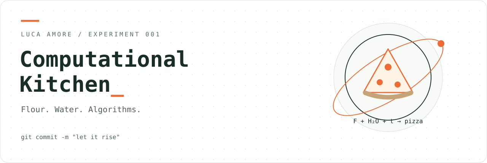

<div align="center">



# Computational Kitchen

**Flour. Water. Algorithms.**

**An AI-assisted playground for experimental recipes.**

A kitchen with source code. An engineer with a dough scraper.

[](https://github.com/lookee/computational-kitchen/actions/workflows/ci.yml)
[](https://github.com/lookee/computational-kitchen/actions/workflows/pages.yml)
[](LICENSE)


[Open the kitchen](https://lookee.github.io/computational-kitchen/) · [Pizza Computational Lab](https://lookee.github.io/computational-kitchen/pizza-computational-lab/) · [Italiano](README.it.md) · [Luca Amore](https://www.lucaamore.com)

</div>

> `git commit -m "let it rise"`

Computational Kitchen is **Luca Amore’s open-source playground for experimental, AI-assisted recipes**: a place to explore ideas, turn kitchen questions into code, and learn by cooking. AI helps with ideation, prototyping and documentation; observations from the kitchen help challenge the assumptions.

It starts with pizza: ingredient mass balance, explicit assumptions, useful timelines, and a calculator whose equations you can actually inspect. The published tools run locally in the browser; there is no AI service, API key or chat model built into the app.

The browser does the work. Your dough still gets the final vote.

## Experiment 001 — Pizza Computational Lab

The original Pizza Lab Playground, packaged as the first experiment in this kitchen.

| Ingredient | What the lab does |
| :--- | :--- |
| **Recipe** | Pizza count and ball weight, hydration, calculated salt at 2.5% of flour, optional calculated oil presets |
| **Method** | Direct dough, poolish or biga; optional autolyse; optional refrigerator, off by default |
| **Machine** | TM5, TM6 and TM7 instructions, batch splitting, ingredient weighing and timed actions |
| **Clock** | Start-time or first-bake planning, automatic editable final proof, live phase and action progress |
| **Flour** | Technical catalogue, source links and exploratory rise-and-loss-of-strength curves |
| **Math** | Documented equations in MathML with LaTeX source; empirical and experimental thermal models |
| **Output** | Italian / English, local PDF generation, printable checklist, calendar export and recipe copy |
| **Privacy** | No accounts, backend or telemetry; preferences stay in browser local storage |

Fresh yeast is displayed to **0.1 g**. That is a weighing resolution, not a guarantee of accuracy. Positive doses below 0.1 g are flagged and must not be silently rounded to zero.

### The equation before the toppings

For a direct dough, with flour-relative mass ratios:

$$F=\frac{M}{1+h+s+o+q},\qquad W=hF,\quad S=sF,\quad O=oF,\quad Y=qF$$

Here $M$ is total dough mass, $h$ hydration, $s=0.025$ salt, $o$ oil and $q$ fresh yeast, all as fractions of flour mass. For indirect dough the flour, water and yeast are split between preferment and final mix.

The rest of the model, units and limitations are documented [here](docs/SCIENCE.md) and inside the app. The empirical yeast model references the [Calcolapizza website](https://laconfraternitadellapizza.net/calcolapizza/).

**Scientific honesty is a feature.** The fermentation curves are heuristic simulations, not measured flour performance or validated predictions. A flour's W does not determine a universal “perfect time”. The thermal model and personal calibration are exploratory. Observe temperature, extensibility, gas retention and the actual dough.

## Boot the kitchen

For the pizza app alone, open [`pizza-computational-lab/index.html`](pizza-computational-lab/index.html) in a current browser. The HTML includes its runtime and PDF fonts. Once downloaded, the app runs offline; following external references still needs a connection. Browser settings can affect local-file storage and downloads.

For the complete site and development checks, use **Node.js 22 or 24** (24 is in `.nvmrc`):

```sh
git clone https://github.com/lookee/computational-kitchen.git
cd computational-kitchen
npm ci --ignore-scripts
npm run check
npm start
```

Open **http://127.0.0.1:8000/computational-kitchen/**. The server also supports `/` and binds to your own computer. No npm packages are downloaded: the project has zero package dependencies. Node is development tooling; visitors only need a browser.

| Command | Result |
| :--- | :--- |
| `npm test` | Runs 12 regression suites in separate processes |
| `npm run build` | Checks inline JavaScript and copies only public files into `_site/` |
| `npm run check` | Tests and builds the site |
| `npm start` | Serves the built site locally on port 8000 |

## Ship it — GitHub Pages

1. Open repository **Settings → Pages**.
2. Choose **GitHub Actions** under **Build and deployment → Source**.
3. Open **Actions → Pages → Run workflow**, selecting `main`.

After configuration, pushes to `main` test, build and deploy the site. The workflow uploads **one** Pages artifact and uses separate build/deploy jobs with limited permissions. Before Pages is configured, it tests and builds, then explains setup in the run summary instead of attempting a deployment.

The links above are the expected project-site URLs; they become available after the first successful deployment. See [deployment and troubleshooting](docs/DEPLOYMENT.md), including custom domains and fork setup.

## Pantry layout

| Path | Purpose |
| :--- | :--- |
| [`index.html`](index.html) | Computational Kitchen landing page |
| [`pizza-computational-lab/`](pizza-computational-lab/) | Self-contained pizza application |
| [`assets/`](assets/) | Repository banner and site favicon, no tracking assets |
| [`tests/`](tests/) | Engine, schedules, rounding, formulas and PDF regressions |
| [`scripts/`](scripts/) | Dependency-free testing, build, preview and Pages preflight |
| [`docs/`](docs/) | Scientific notes, architecture, deployment and testing |
| [`.github/`](.github/) | CI, Pages, issue forms, pull request template and Action updates |

## Lab notebook

- **Report a bug:** include a minimal recipe, expected result and actual result. Please remove private calendar details.
- **Improve a model:** state units, assumptions, reference sources and how it was checked.
- **Add an experiment:** keep it self-contained where practical, document it and explicitly add its public directory to the build.
- **Found a vulnerability?** See [SECURITY.md](SECURITY.md).

Read [CONTRIBUTING.md](CONTRIBUTING.md), [the architecture](docs/ARCHITECTURE.md), [test coverage](docs/TESTING.md) and [the changelog](CHANGELOG.md).

## License, credits and small print

Copyright © 2026 **[Luca Amore](https://www.lucaamore.com)**. Code is licensed under **GNU GPL v3 only**; see [LICENSE](LICENSE). Embedded Liberation-derived font subsets retain **SIL OFL 1.1**, with notices in [LICENSES](LICENSES/Liberation-Fonts.txt) and [THIRD_PARTY_NOTICES.md](THIRD_PARTY_NOTICES.md).

Bimby® and Thermomix® are registered trademarks of the Vorwerk group. This independent project is not affiliated with, sponsored by or approved by Vorwerk. Flour and appliance names identify referenced products. Follow the manual and limits for your machine; the procedures are personalised adaptations.

Software is provided without warranty under the license. Tests check software behaviour; they do not validate fermentation biology or replace observation of the dough.

<div align="center"><sub>Made with curiosity, JavaScript, and a statistically significant amount of flour.<br>May your crust be open and your issues reproducible.</sub></div>
