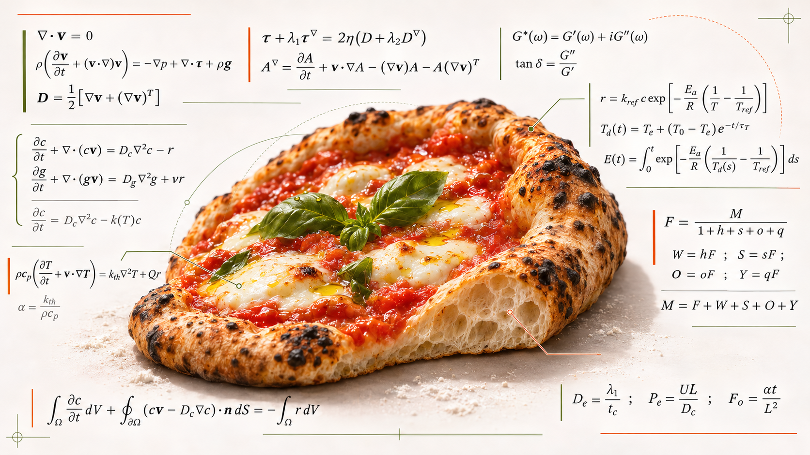
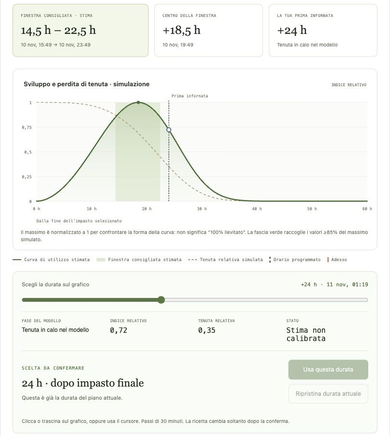
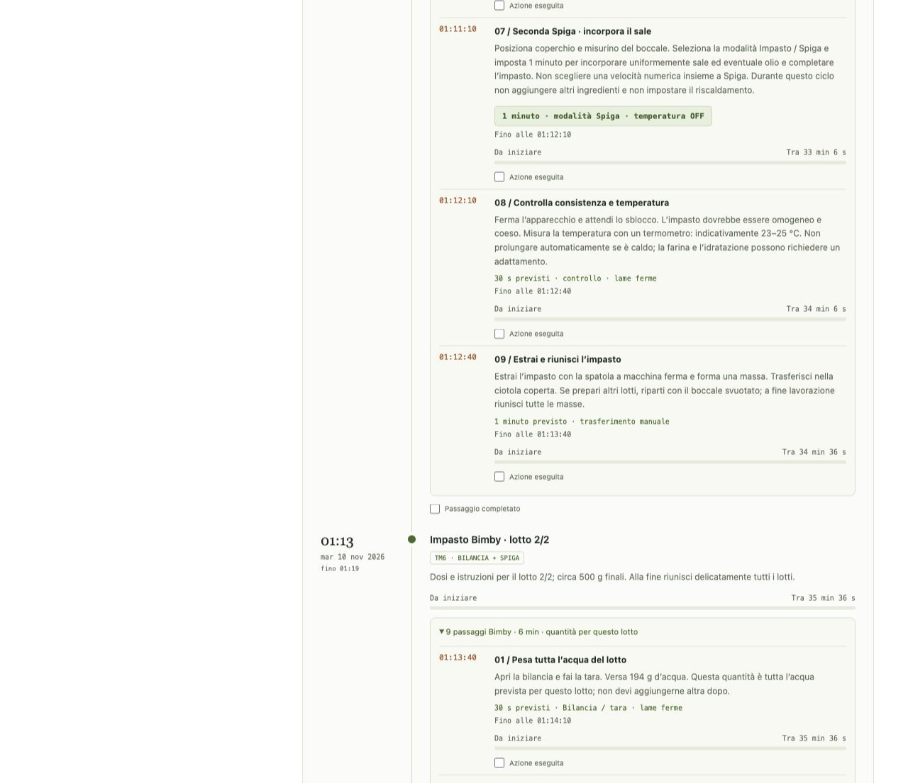
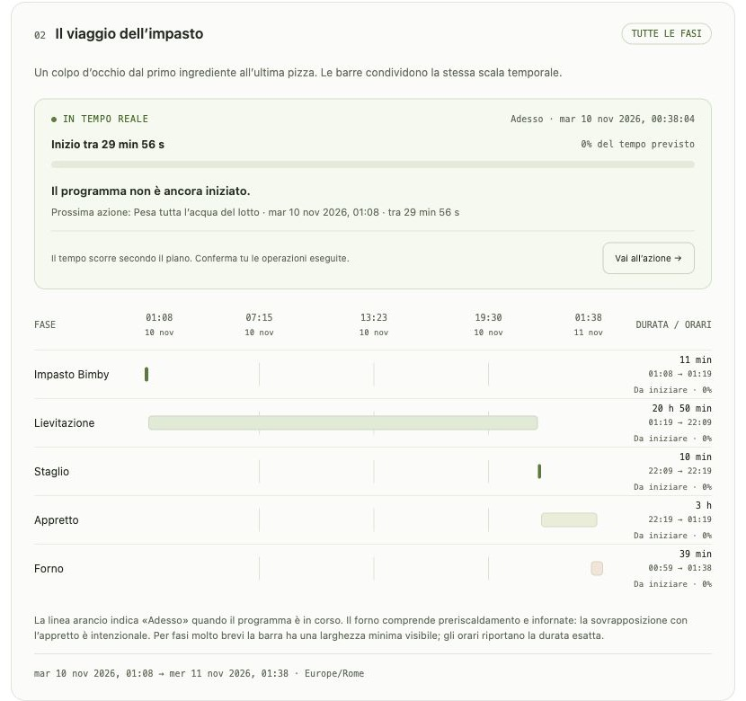

# Computational Kitchen

### 🍕 [Pizza Computational Lab (Bimby / Thermomix) →](https://lookee.github.io/computational-kitchen/pizza-computational-lab.html)

[Italiano](#italiano) · [English](#english)

---

## Italiano

**Un laboratorio di cucina computazionale: ricette riproducibili, modelli scientifici e strumenti interattivi per esplorare impasti, fermentazioni e cotture.**

Uno spazio di [Luca Amore](https://www.lucaamore.com) per ideare ricette, costruire piccoli strumenti e mettere alla prova le ipotesi ai fornelli. L’AI aiuta a progettare gli esperimenti; è l’impasto ad avere l’ultima parola.

### 🍕 Pizza Computational Lab

**Il primo progetto di Computational Kitchen:** un laboratorio interattivo dedicato alla pizza, per progettare l’impasto dalle quantità alla prima infornata.

**[Apri Pizza Computational Lab (Bimby) →](https://lookee.github.io/computational-kitchen/pizza-computational-lab.html)**

- **Metodi di impasto:** diretto, poolish e biga, con autolisi e frigorifero opzionali.
- **Dosi e lavorazioni:** ingredienti calcolati, passaggi Bimby TM5/TM6/TM7 e timeline delle lavorazioni.
- **Esplorazione:** formule documentate, catalogo farine e curve esplorative della fermentazione.
- **Lingue ed esportazione:** interfaccia italiana e inglese, scheda stampabile, PDF e calendario.

#### L’app in azione

**Esplora la lievitazione sul grafico.** La curva mostra sviluppo relativo, finestra consigliata stimata e orario della prima infornata; il cursore permette di esplorare una durata prima di confermarla. Le curve sono simulazioni indicative, non misure o previsioni validate.

**Progetta il tuo impasto.** Metodo, idratazione, ingredienti e riepilogo del programma in un’unica interfaccia.

**Segui il viaggio dell’impasto.** Una timeline mette in relazione impasto Bimby, lievitazione, staglio, appretto e forno.

*Screenshot dell’app in italiano. Clicca sulle immagini per aprirle a dimensione originale.*

#### Online oppure sul tuo PC

Puoi scegliere come utilizzare il laboratorio:

- **Online:** [apri Pizza Computational Lab (Bimby)](https://lookee.github.io/computational-kitchen/pizza-computational-lab.html) e usalo direttamente nel browser.
- **Sul tuo PC, anche offline:** apri la pagina online e premi **↓ Sorgente HTML** in fondo alla pagina. Salva il file [pizza-computational-lab.html](pizza-computational-lab.html) sul computer e aprilo con il browser quando vuoi, anche senza connessione.

L’app è contenuta in un solo file e non richiede installazioni, account o chiavi API.

L’app non integra un servizio AI; le curve sono simulazioni indicative, non previsioni validate.

### Autore e licenza

**[Luca Amore](https://www.lucaamore.com)** · [GNU GPL v3](LICENSE).

Le attribuzioni e la licenza SIL OFL 1.1 dei font PDF sono incluse nell’HTML. Bimby® e Thermomix® sono marchi registrati del gruppo Vorwerk: questo progetto è indipendente e non affiliato.

---

## English

**A computational kitchen lab: reproducible recipes, scientific models, and interactive tools to explore dough, fermentation, and baking.**

A space by [Luca Amore](https://www.lucaamore.com) to develop recipes, build small tools, and test ideas in the kitchen. AI helps design the experiments; the dough has the final say.

### 🍕 Pizza Computational Lab

**The first project in Computational Kitchen:** an interactive pizza lab for planning your dough, from ingredient quantities to the first bake.

**[Open Pizza Computational Lab (Thermomix) →](https://lookee.github.io/computational-kitchen/pizza-computational-lab.html)**

- **Dough methods:** direct dough, poolish, and biga, with optional autolyse and refrigeration.
- **Quantities and workflow:** calculated ingredients, Bimby/Thermomix TM5/TM6/TM7 instructions, and a preparation timeline.
- **Exploration:** documented formulas, a flour catalog, and exploratory fermentation curves.
- **Languages and export:** Italian and English interface, printable recipe sheet, PDF, and calendar export.

#### See the app in action

[View the screenshots ↑](#lapp-in-azione): explore the interactive fermentation graph, dough configuration, and preparation timeline. Screenshots show the Italian interface; the app is also available in English. The curves are illustrative simulations, not validated predictions.

#### Online or on your computer

Choose how you want to use the lab:

- **Online:** [open Pizza Computational Lab (Thermomix)](https://lookee.github.io/computational-kitchen/pizza-computational-lab.html) and use it directly in your browser.
- **On your computer, including offline:** open the online page and click **↓ HTML source** at the bottom. Save [pizza-computational-lab.html](pizza-computational-lab.html) to your computer, then open it in your browser whenever you like, even without an internet connection.

The app is contained in a single file and requires no installation, account, or API keys.

The app does not integrate an AI service; its curves are illustrative simulations, not validated predictions.

### Author and license

**[Luca Amore](https://www.lucaamore.com)** · [GNU GPL v3](LICENSE).

Attributions and the SIL OFL 1.1 license for the PDF fonts are included in the HTML. Bimby® and Thermomix® are registered trademarks of the Vorwerk Group. This project is independent and unaffiliated.
