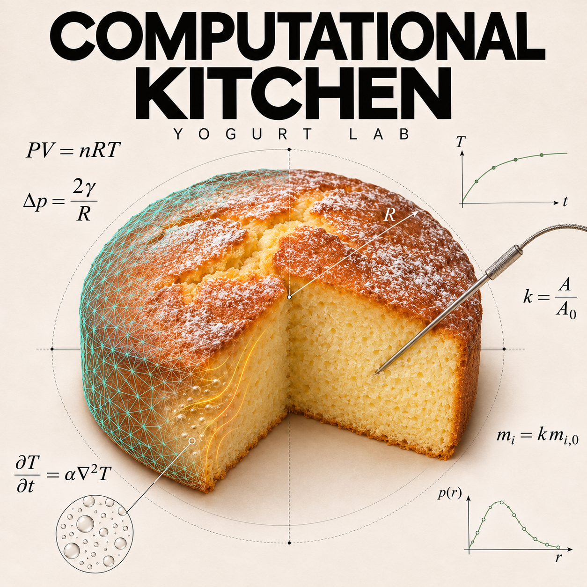
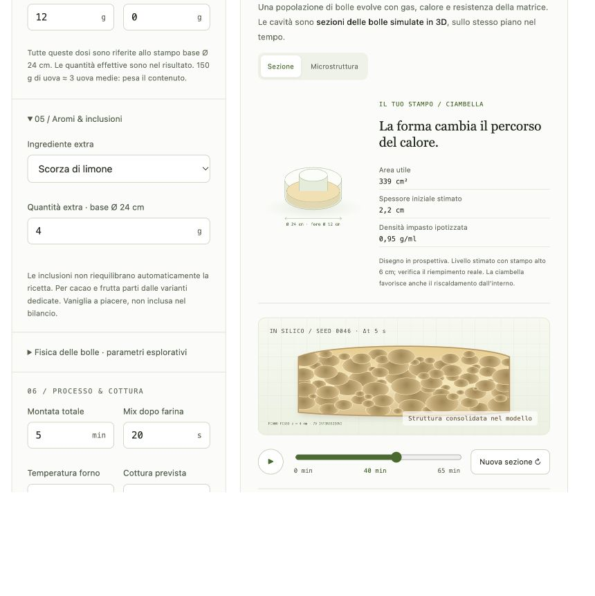

# Computational Kitchen

### Good food. Better questions. A little mathematics.

**Two interactive food-science labs by [Luca Amore](https://www.lucaamore.com). Explore pizza dough and yogurt cake through recipes, visual models and experiments you can repeat in your own kitchen.**

**[Open the kitchen →](https://lookee.github.io/computational-kitchen/)** · [Italiano](#italiano) · [English](#english) · [GPL v3](LICENSE)

<table>
<tr>
<td width="50%" align="center"><a href="https://lookee.github.io/computational-kitchen/pizza-computational-lab.html"></a><h3>Pizza Computational Lab</h3><p>Dough · fermentation · timing<br>Impasto · lievitazione · orari</p><p><a href="https://lookee.github.io/computational-kitchen/pizza-computational-lab.html"><strong>Open / Apri Pizza Lab →</strong></a></p></td>
<td width="50%" align="center"><a href="https://lookee.github.io/computational-kitchen/yogurt-computational-lab.html"></a><h3>Yogurt Computational Lab</h3><p>Crumb · heat · nutrition<br>Mollica · calore · nutrizione</p><p><a href="https://lookee.github.io/computational-kitchen/yogurt-computational-lab.html"><strong>Open / Apri Yogurt Lab →</strong></a></p></td>
</tr>
</table>

**Browser-based · Offline-ready · No account or API key · Bimby / Thermomix TM5, TM6 & TM7**

---

## Italiano

### La ricetta è il punto di partenza. Il laboratorio è quello che succede dopo.

Quanto cambia una torta scegliendo un’altra farina? Come si incastrano impasto, frigorifero e prima infornata? Computational Kitchen trasforma queste domande in strumenti da esplorare: modifica un parametro, osserva il modello, prepara la ricetta e confronta il risultato reale.

Il progetto nasce dalla curiosità di unire cucina, matematica e sviluppo software. L’AI aiuta a progettare e costruire gli esperimenti; la prova ai fornelli rimane decisiva. Le app non richiedono un servizio AI durante l’uso.

### Scegli il tuo esperimento

| | 🍕 Pizza Lab | 🍰 Yogurt Lab |
|---|---|---|
| **Progetta** | Diretto, poolish e biga; autolisi e frigo opzionali | 11 varianti; stampi tondi, ciambelle e plumcake |
| **Confronta** | Farine, idratazione e curve di fermentazione | 10 farine commerciali, incluse 4 Caputo; formulazioni e nutrienti |
| **Esplora** | Formule documentate e finestre di lievitazione indicative | Popolazione 3D di bolle, crescita, coalescenza e consolidamento |
| **Prepara** | Passaggi Bimby e timeline con orari | Modalità cucina, timer e sonda al cuore opzionale, attiva di default |
| **Conserva** | Scheda stampabile, PDF e calendario | Quaderno esperimenti, import/export JSON e stampa/PDF |
| **Interfaccia** | Italiano / English | Italiano; documentazione del progetto bilingue |
| **Entra** | **[Apri Pizza Lab →](https://lookee.github.io/computational-kitchen/pizza-computational-lab.html)** | **[Apri Yogurt Lab →](https://lookee.github.io/computational-kitchen/yogurt-computational-lab.html)** |

### Dal grafico alla cucina

**Pizza: il tempo diventa visibile.** Esplora la curva di fermentazione e pianifica le lavorazioni fino al forno.

[](https://lookee.github.io/computational-kitchen/pizza-computational-lab.html)

**Yogurt: guarda dentro la mollica.** Cambia dosi e processo, esplora la popolazione di bolle e confronta tutte le ricette. Le letture reali della sonda restano separate dalle curve simulate.

[](https://lookee.github.io/computational-kitchen/yogurt-computational-lab.html)

### Online in un clic. Offline in un file.

Apri uno dei laboratori dalla [pagina iniziale](https://lookee.github.io/computational-kitchen/). Per usarlo offline, scarica il relativo HTML con **Download raw file** su GitHub, poi aprilo nel browser:

- [Pizza — file HTML](pizza-computational-lab.html)
- [Yogurt — file HTML](yogurt-computational-lab.html)

Ogni app è autonoma: nessuna installazione, account o chiave API. I calcoli avvengono nel browser. Il quaderno Yogurt resta nel browser e nell’origine in cui lo hai creato: esporta un backup JSON per trasferirlo tra versione online e file offline.

### Scienza aperta, limiti espliciti

Le formule e le fonti sono consultabili nelle app. Le simulazioni sono strumenti esplorativi: non sono previsioni validate della fermentazione o dell’alveolatura reale. La nutrizione è stimata da ingredienti e peso cotto, non certificata da un laboratorio. La temperatura al cuore va letta insieme ai segni di cottura. Per il Bimby segui il manuale e i limiti del tuo modello.

Hai provato una variante? [Apri una issue](https://github.com/lookee/computational-kitchen/issues) con dosi, farina, stampo, forno, tempi e risultato: un esperimento riproducibile vale più di una promessa.

---

## English

### A recipe is the starting point. The lab is what happens next.

What changes when you choose a different flour? How do mixing, refrigeration and the first bake fit together? Computational Kitchen turns those questions into hands-on tools: change a parameter, explore the model, bake the recipe and compare it with the real result.

This project brings together cooking, mathematics and software. AI helps design and build the experiments; practical baking remains the deciding test. The apps do not need an AI service at runtime.

### Choose your experiment

| | 🍕 Pizza Lab | 🍰 Yogurt Lab |
|---|---|---|
| **Design** | Direct dough, poolish and biga; optional autolyse and cold fermentation | 11 variations; round, ring and loaf pans |
| **Compare** | Flours, hydration and fermentation curves | 10 branded flours, including 4 Caputo profiles; formulations and nutrients |
| **Explore** | Documented formulas and indicative fermentation windows | A 3D bubble population: growth, coalescence and matrix setting |
| **Bake** | Thermomix steps and a preparation timeline | Cooking mode, manual timers and optional core-temperature readings, enabled by default |
| **Keep** | Printable recipe, PDF and calendar export | Experiment notebook, JSON import/export and print/PDF |
| **Interface** | English / Italian | Italian; bilingual project documentation |
| **Start** | **[Open Pizza Lab →](https://lookee.github.io/computational-kitchen/pizza-computational-lab.html)** | **[Open Yogurt Lab →](https://lookee.github.io/computational-kitchen/yogurt-computational-lab.html)** |

### From the chart to your kitchen

[See the apps in action above](#dal-grafico-alla-cucina): explore Pizza Lab’s fermentation graph and Yogurt Lab’s pan geometry and bubble simulation. Screenshots show the Italian interfaces.

### One click online. One file offline.

Choose a lab on the [homepage](https://lookee.github.io/computational-kitchen/). To use it offline, open the [Pizza HTML](pizza-computational-lab.html) or [Yogurt HTML](yogurt-computational-lab.html) on GitHub, select **Download raw file**, then open the saved file in your browser. No installation, account or API key is needed. Calculations run in your browser. Yogurt notebook data is stored per browser and origin; export JSON to move it between the website and your offline copy.

### Open science, explicit limits

Both apps expose their formulas and sources. Their simulations are exploratory models, not validated forecasts of fermentation or actual cake crumb. Nutrition is estimated from ingredients and cooked weight, not laboratory-certified. Use thermometer readings alongside structural signs of doneness, and follow the manual and limits of your Thermomix model.

Tried a variation? [Open an issue](https://github.com/lookee/computational-kitchen/issues) with quantities, flour, pan, oven, timing and results. Reproducible experiments help improve the lab.

---

### Build, inspect, contribute / Sviluppa, verifica, contribuisci

Yogurt’s editable sources and data provenance live in [`yogurt-lab/`](yogurt-lab/). Run its numerical checks with:

```sh
node --test yogurt-lab/tests/*.test.cjs
node yogurt-lab/build.mjs
```

The build regenerates the standalone HTML. Pizza remains available in its original standalone file. Contributions are welcome through issues and pull requests; include the assumptions and a reproducible case when changing a model.

**[Luca Amore](https://www.lucaamore.com) · [GNU GPL v3](LICENSE)**

Pizza’s embedded PDF fonts retain their SIL OFL 1.1 notices. Editorial covers are AI-generated illustrations. Bimby® and Thermomix® are Vorwerk trademarks; Computational Kitchen is independent and unaffiliated. / I font PDF di Pizza conservano le attribuzioni SIL OFL 1.1. Le copertine editoriali sono illustrazioni generate con AI. Progetto indipendente, non affiliato a Vorwerk.
